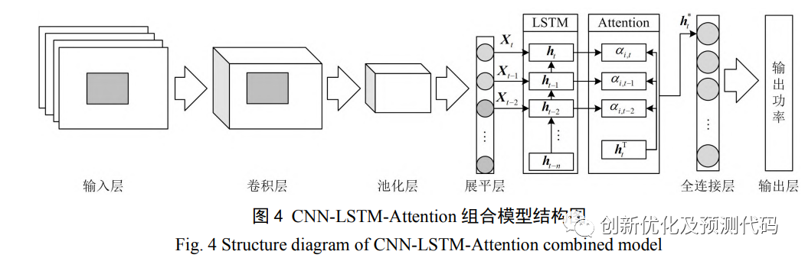
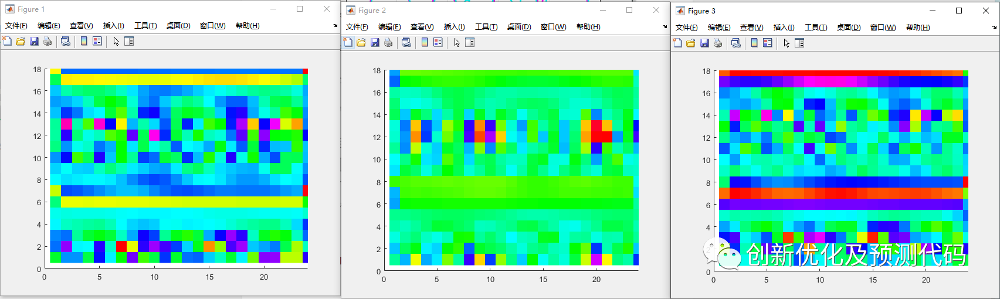
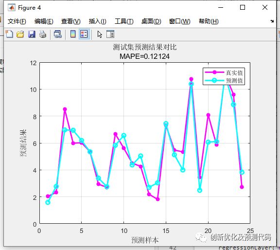

# TSOA-CNN-LSTM-Attention Multi-Feature Regression Prediction, Advanced 24-Step Forecasting Algorithm

The Transit Search Optimization Algorithm (TSOA) was introduced in August 2022 as a novel metaheuristic algorithm. When a planet passes in front of its star, it causes the brightness of the star to slightly decrease, known as an eclipse.

This algorithm is based on the well-known method for extraterrestrial planetary exploration, namely transit search (TS). In the transit algorithm, by studying the light received from the star over a certain interval, changes in brightness are checked. If the amount of light received decreases, it indicates that a planet has passed in front of the star. This approach is highly innovative. The algorithm was proposed very recently and there are no existing literatures applying this algorithm yet. It's first come, first served!

The optimization process of TSOA includes the following stages:
Galaxy stage: Select random points within the search space as the center of the galaxy, determine the habitable region, and select the area with the best potential for survival.
Transit stage: Re-measure the amount of light received from the body to detect if the signal decreases to confirm whether a planet has passed.
Planet stage: If an eclipse is detected, determine the initial position of the planet and update its position.
Neighborhood stage: If no eclipse is detected, analyze possible planets near the current star body.
Development stage: Analyze the characteristics and conditions of the planet to evaluate its potential as a host for life.
Each stage involves complex equations and probability calculations, simulating the process of discovering and evaluating planets through astronomical observations. The mathematical innovation of this algorithm mainly lies in introducing the principle of transit observation and the concept of signal-to-noise ratio into the solution of optimization problems, which is unique in multiple benchmark problems.
Dataset format:
18 meteorological features for the previous day, sampling time is 24 hours, output is the power output for the next day's 24 hours, i.e., 18×24 input, 1×24 output, totaling 75 such samples.
\n        \n      Model Structure:
Convolutional Layers for feature extraction visualization:
Comparison of predictions after 24 steps:
Partial model code:
function [Bests] = TransitSearch (ObjectiveFunction,Vmin,Vmax,nV,ns,SN,maxcycle)\n%% Initialization\nEmpty.Location = [];\nEmpty.Cost = inf;\nEmpty.Value = {};\nEmpty.net = {};\nEmpty.info = {};\nGalaxy_Center = repmat (Empty, 1, 1);\nregion = repmat (Empty, ns*SN, 1);\nselected_regions = repmat (Empty, ns, 1);\nStars = repmat (Empty, ns, 1);\nStars_sorted = zeros(ns,1);\nRanks = 1:1:ns;\nStars_Ranks = zeros(ns,1);\nLuminosity = zeros(ns,1);\nStar_RanksNormal = zeros(ns,1);\nDistance = zeros(ns,1);\nTransit0 = zeros(ns,1);\nSN_P = repmat (Empty, SN, 1);\nBests=region;\nif length(Vmin) ~= nV\n    Vmin=Vmin*ones(1,nV);\n    Vmax=Vmax*ones(1,nV);\nend\n%% Galaxy phase\n% The initial position of the center of the Milky Way\nGalaxy_Center.Location = unifrnd(Vmin,Vmax,1,nV);\nGalaxy_Center.Cost = ObjectiveFunction(Galaxy_Center.Location);\n% Galaxy residential area\nfor l = 1:(ns*SN)\n    zone = randi(2);\n    if zone ==1\n        difference = rand().*(Galaxy_Center.Location)-(unifrnd(Vmin,Vmax,1,nV));\n    else\n        difference = rand().*(Galaxy_Center.Location)+(unifrnd(Vmin,Vmax,1,nV));\n    end\n    Noise = ((rand(1,nV)).^3).*(unifrnd(Vmin,Vmax,1,nV));\n    region(l).Location = Galaxy_Center.Location + difference - Noise;\n    region(l).Location = max(region(l).Location, Vmin);\n    region(l).Location = min(region(l).Location, Vmax);\n    [region(l).Cost,region(l).Value,region(l).net,region(l).info] = ObjectiveFunction(region(l).Location);\nend\n% The percentage of stars selected from the Milky Way's Milky Way Habitat\n[Sort,index]=sort([region.Cost]);\nfor i = 1:ns\n    selected_regions(i) = region(index(1,i));\n    for k = 1:SN\n        zone = randi(2);\n        if zone ==1\n            difference = rand().*(selected_regions(i).Location)-rand().*(unifrnd(Vmin,Vmax,1,nV));\n        else\n            difference = rand().*(selected_regions(i).Location)+rand().*(unifrnd(Vmin,Vmax,1,nV));\n        end\n        Noise = ((rand(1,nV)).^3).*(unifrnd(Vmin,Vmax,1,nV));\n        new.Location = selected_regions(i).Location + difference - Noise;\n        new.Location = max(new.Location, Vmin);\n        new.Location = min(new.Location, Vmax);\n        [new.Cost,new.Value,new.net,new.info] = ObjectiveFunction(new.Location);\n        if new.Cost < Stars(i).Cost\n            Stars(i) = new;\n        end\n    end\nend\n% Best planet's initial position (starting point: its star)\nBest_Planets = Stars;\n% Best planet format\n[Sort,index]=sort([Best_Planets.Cost]);\nBest_Planet = Best_Planets(index(1,1));\n% Telescope position\nTelescope.Location = unifrnd(Vmin,Vmax,1,nV);\n% Determination of stellar luminosity\nfor i = 1:ns\n    Stars_sorted(i,1) = Stars(i).Cost;\nend\nStars_sorted = sort (Stars_sorted);\nfor i = 1:ns\n    for ii = 1:ns\n        if Stars(i).Cost == Stars_sorted(ii,1)\n            Stars_Ranks(i,1) = Ranks(1,ii);\n            Star_RanksNormal(i,1) = (Stars_Ranks(i,1))./ns;\n        end\n    end\n    Distance(i,1) = sum((Stars(i).Location-Telescope.Location).^2).^0.5;\n    Luminosity(i,1) = Star_RanksNormal(i,1)/((Distance(i,1))^2);\nend\nLuminosity_new = Luminosity;\nStars2 = Stars;\n%% TS Algorithm Loop\nfor it = 1:maxcycle\n    \n    %% Transitional phase\n    Transit = Transit0;\n    Luminosity = Luminosity_new;\n    \n    for i = 1:ns\n        difference = (2*rand()-1).*(Stars(i).Location);\n        Noise = ((rand(1,nV)).^3).*(unifrnd(Vmin,Vmax,1,nV));\n        Stars2(i).Location = Stars(i).Location + difference - Noise;\n        Stars2(i).Location = max(Stars2(i).Location, Vmin);\n        Stars2(i).Location = min(Stars2(i).Location, Vmax);\n        [Stars2(i).Cost,Stars2(i).Value,Stars2(i).net,Stars2(i).info] = ObjectiveFunction(Stars2(i).Location);\n    end\n    \n    for i = 1:ns\n        Stars_sorted(i,1) = Stars2(i).Cost;\n    end\n    Stars_sorted = sort (Stars_sorted);\n    for i = 1:ns\n        for ii = 1:ns\n            if Stars2(i).Cost == Stars_sorted(ii,1)\n                Stars_Ranks(i,1) = Ranks(1,ii);\n                Star_RanksNormal(i,1) = (Stars_Ranks(i,1))./ns;\n            end\n        end\n        Distance(i,1) = sum((Stars2(i).Location-Telescope.Location).^2).^0.5;\n        Luminosity_new(i,1) = Star_RanksNormal(i,1)/((Distance(i,1))^2);\n        if Luminosity_new(i,1) < Luminosity(i,1)\n            Transit (i,1) = 1;      % Has transit been observed?  0 = No; 1 = Yes\n        end\n    end\n    Stars = Stars2;\n    \n   %% Exploration phase (locate)\n    for i = 1:ns\n        if Transit (i,1) == 1\n            \n            % Determine the planet's position\n            Luminosity_Ratio = Luminosity_new(i,1)/Luminosity(i,1);\n            Planet.Location = (rand().*Telescope.Location + Luminosity_Ratio.*Stars(i).Location)./2;\n            \n            for k = 1:SN\n                zone = randi(3);\n                if zone ==1\n                    new.Location = Planet.Location - (2*rand()-1).*(unifrnd(Vmin,Vmax,1,nV));\n                elseif zone ==2\n                    new.Location = Planet.Location + (2*rand()-1).*(unifrnd(Vmin,Vmax,1,nV));\n                else\n                    new.Location = Planet.Location + (2.*rand(1,nV)-1).*(unifrnd(Vmin,Vmax,1,nV));\n                end\n                new.Location = max(new.Location, Vmin);\n                new.Location = min(new.Location, Vmax);\n                SN_P(k) = new;\n            end\n            SUM = 0;\n            for k = 1:SN\n                SUM = SUM+SN_P(k).Location;\n            end\n            new.Location = SUM./SN;\n            [new.Cost,new.Value,new.net,new.info] = ObjectiveFunction(new.Location);\n            \n            if new.Cost < Best_Planets(i).Cost\n                Best_Planets(i) = new;\n            end\n            \n        else  % No eclipse observed: Proximity planet\n            \n            Neighbor.Location = (rand().*Stars(i).Location + rand().*(unifrnd(Vmin,Vmax,1,nV)))./2;\n            \n            for k = 1:SN\n                zone = randi(3);\n                if zone ==1\n                    Neighbor.Location = Neighbor.Location - (2*rand()-1).*(unifrnd(Vmin,Vmax,1,nV));\n                elseif zone ==2\n                    Neighbor.Location = Neighbor.Location + (2*rand()-1).*(unifrnd(Vmin,Vmax,1,nV));\n                else\n                    Neighbor.Location = Neighbor.Location + (2.*rand(1,nV)-1).*(unifrnd(Vmin,Vmax,1,nV));\n                end\n                Neighbor.Location = max(Neighbor.Location, Vmin);\n                Neighbor.Location = min(Neighbor.Location, Vmax);\n                [Neighbor.Cost,Neighbor.Value,Neighbor.net,Neighbor.info] = ObjectiveFunction (Neighbor.Location);\n                SN_P(k) = Neighbor;\n            end\n            SUM = 0;\n            for k = 1:SN\n                SUM = SUM+SN_P(k).Location;\n            end\n            Neighbor.Location = SUM./SN;\n            [Neighbor.Cost,Neighbor.Value,Neighbor.net,Neighbor.info] = ObjectiveFunction (Neighbor.Location);\n            \n            if Neighbor.Cost < Best_Planets(i).Cost\n                Best_Planets(i) = Neighbor;\n            end\n        end\n    end\n    \n   %% Best Planet Signal Amplification (Exploration)\n    for i = 1:ns\n        for k = 1:SN\n            RAND = randi(2 );\n            if RAND ==1\n                Power = randi(SN*ns);\n                Coefficient = 2*rand();\n                Noise = ((rand(1,nV)).^Power).*(unifrnd(Vmin,Vmax,1,nV));\n            else\n                Power = randi(SN*ns);\n                Coefficient = 2*rand();\n                Noise = -((rand(1,nV)).^Power).*(unifrnd(Vmin,Vmax,1,nV));\n            end\n          \n            chance = randi(2);\n            if chance ==1\n                new.Location = Best_Planets(i).Location - Coefficient.*Noise;\n            else\n                new.Location = (rand().*Best_Planets(i).Location) - Coefficient.*Noise;\n            end\n            new.Location = max(new.Location, Vmin);\n            new.Location = min(new.Location, Vmax);\n            [new.Cost,new.Value,new.net,new.info] = ObjectiveFunction(new.Location);\n            \n            \n            if new.Cost < Best_Planets(i).Cost\n                Best_Planets(i) = new;\n            end\n        end\n        if Best_Planets(i).Cost < Best_Planet.Cost\n            Best_Planet = Best_Planets(i);\n        end\n    end\n    \n    % Result\n    Bests(it)=Best_Planet;\n   \nend\nend\n  

## Images

<!-- PAYMENT_BLOCK -->

## Get this dataset

- Payment link (Stripe): [Buy now](https://buy.stripe.com/3cs8yP7sY87d0vu9AB)
- Payment QR code: 

<!-- /PAYMENT_BLOCK -->
